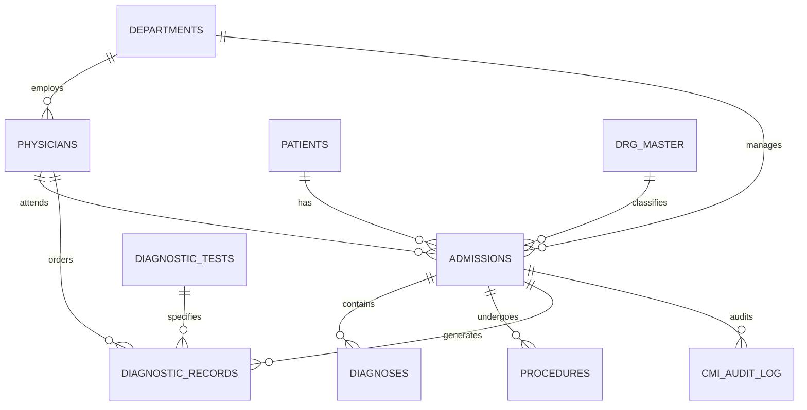

# Healthcare Diagnostic Records & Case Mix (CMI) System
## Database Management System (DBMS) Technical Specification & Relational Model

This document provides complete academic and enterprise-grade DBMS technical documentation for the **AegisCare™ Healthcare Diagnostic Records & Case Mix Management System**.

---

## 1. System Overview & Problem Formulation

Modern hospital networks require an integrated data architecture that links:
1. **Clinical Diagnoses & Coding**: Standardized under ICD-10 (International Classification of Diseases, 10th Revision).
2. **Diagnostic & Laboratory Investigations**: Quantitative pathology, microbiology, radiology, and biochemistry records with automated physiological reference-range monitoring and critical triage flagging.
3. **Case Mix Index (CMI) & DRGs**: Diagnosis-Related Groups (CMS MS-DRGs) used for hospital reimbursement, resource allocation, and measuring clinical patient illness severity (acuity).

### Mathematical Formulation of Case Mix Index (CMI)

The Case Mix Index is an essential metric in healthcare database management. It quantifies the relative clinical complexity and resource utilization of a hospital's patient population:

$$\text{Hospital CMI} = \frac{\sum_{i=1}^{N} \text{Relative Weight}_i}{\text{Total Number of Discharges}}$$

Where:
* $N$ is the total count of discharged hospital inpatient encounters.
* $\text{Relative Weight}_i$ is the CMS-assigned relative value unit of the Diagnosis-Related Group (MS-DRG) assigned to discharge $i$.
* A CMI value $> 1.00$ indicates a higher proportion of complex, resource-intensive patients (e.g., intensive surgical cases, organ transplants, severe sepsis).
* Departmental CMI is formulated similarly:
$$\text{Department CMI}_d = \frac{\sum_{j \in \text{Dept } d} \text{Relative Weight}_j}{\text{Discharges}_d}$$

---

## 2. Entity-Relationship (ER) Architecture

---

## 3. Relational Database Schema & Data Dictionary

The database consists of **10 Relational Tables**, **4 Analytical Views**, and **3 Automated DBMS Triggers**.

### Relational Tables

1. **`departments`**: Master hospital department hierarchy and bed capacities.
   * `dept_id` (PK, INTEGER)
   * `dept_code` (VARCHAR(10), UNIQUE, NOT NULL)
   * `dept_name` (VARCHAR(100), NOT NULL)
   * `target_cmi` (DECIMAL(4,2), Target benchmark acuity)
   * `bed_capacity` (INTEGER, CHECK > 0)

2. **`physicians`**: Licensed attending clinicians and surgeons.
   * `physician_id` (PK, INTEGER)
   * `license_no` (VARCHAR(50), UNIQUE, NOT NULL)
   * `first_name`, `last_name` (VARCHAR(50), NOT NULL)
   * `specialty` (VARCHAR(100), NOT NULL)
   * `dept_id` (FK &rarr; `departments.dept_id`)

3. **`drg_master`**: CMS Diagnosis-Related Groups and Relative Weights.
   * `drg_id` (PK, INTEGER)
   * `drg_code` (VARCHAR(20), UNIQUE, e.g., 'MS-DRG 291')
   * `drg_title` (VARCHAR(200), NOT NULL)
   * `mdc_code` (VARCHAR(100), Major Diagnostic Category)
   * `relative_weight` (DECIMAL(6,4), CHECK > 0)
   * `geometric_mean_los` (DECIMAL(4,1), CMS benchmark length of stay)
   * `base_payment_rate` (DECIMAL(10,2), Base reimbursement rate)
   * `severity_level` (CHECK: Minor, Moderate, Major (CC), Extreme (MCC))

4. **`patients`**: Master patient demographic and payer records.
   * `patient_id` (PK, INTEGER)
   * `mrn` (VARCHAR(30), UNIQUE, Medical Record Number)
   * `first_name`, `last_name`, `dob`, `gender`, `blood_group`
   * `insurance_provider`, `policy_no`

5. **`admissions`**: Inpatient encounters and hospitalization transactions.
   * `admission_id` (PK, INTEGER)
   * `admission_no` (VARCHAR(30), UNIQUE)
   * `patient_id` (FK &rarr; `patients.patient_id` ON DELETE CASCADE)
   * `dept_id` (FK &rarr; `departments.dept_id`)
   * `attending_physician_id` (FK &rarr; `physicians.physician_id`)
   * `admission_date`, `discharge_date`
   * `admission_type` (CHECK: Emergency, Elective, Urgent, Trauma)
   * `discharge_disposition` (Home, Skilled Nursing, Rehabilitation, Deceased, Inpatient)
   * `assigned_drg_id` (FK &rarr; `drg_master.drg_id`)
   * `total_charges`, `reimbursement_amount`, `los_days`
   * `status` (CHECK: Admitted, Discharged, Transferred)

6. **`diagnoses`**: Standardized ICD-10 coded medical conditions.
   * `diagnosis_id` (PK, INTEGER)
   * `admission_id` (FK &rarr; `admissions.admission_id` ON DELETE CASCADE)
   * `icd10_code` (VARCHAR(20), NOT NULL)
   * `diagnosis_description` (VARCHAR(255), NOT NULL)
   * `diagnosis_type` (CHECK: Principal, Secondary, Comorbidity (CC), Major Comorbidity (MCC))
   * `present_on_admission` (CHAR(1), CHECK: Y, N, U)

7. **`procedures`**: CPT/ICD-10-PCS clinical and surgical interventions.
   * `procedure_id` (PK, INTEGER)
   * `admission_id` (FK &rarr; `admissions.admission_id`)
   * `cpt_code`, `procedure_name`, `procedure_date`
   * `performing_physician_id` (FK &rarr; `physicians.physician_id`)
   * `procedure_cost`

8. **`diagnostic_tests`**: Test catalog defining normal reference ranges and critical alert thresholds.
   * `test_id` (PK, INTEGER)
   * `test_code` (VARCHAR(30), UNIQUE, LOINC-aligned)
   * `test_name`, `category` (Biochemistry, Hematology, Radiology, Microbiology, etc.)
   * `unit`, `normal_range_min`, `normal_range_max`, `critical_low`, `critical_high`

9. **`diagnostic_records`**: Diagnostic lab and imaging test orders and evaluated results.
   * `record_id` (PK, INTEGER)
   * `admission_id` (FK &rarr; `admissions.admission_id`)
   * `test_id` (FK &rarr; `diagnostic_tests.test_id`)
   * `ordered_by_physician_id` (FK &rarr; `physicians.physician_id`)
   * `numeric_result`, `text_result`
   * `flag` (CHECK: NORMAL, LOW, HIGH, CRITICAL, PENDING, ABNORMAL)
   * `reference_range_display`, `interpretation_notes`, `verified_by`, `status`

10. **`cmi_audit_log`**: System transaction log recording automated trigger activations.
    * `log_id` (PK, INTEGER)
    * `action_type`, `table_name`, `record_id`, `description`, `created_at`

---

## 4. Normalization Validation (1NF through BCNF)

* **First Normal Form (1NF)**: Every column holds atomic (indivisible) scalar values. No repeating groups or multi-valued attributes exist (e.g., patient phone numbers, diagnoses, and lab tests are stored in separate normalized relational rows).
* **Second Normal Form (2NF)**: Satisfies 1NF, and all non-key attributes are fully functionally dependent on the entire primary key (every entity uses single-attribute primary keys like `patient_id` or `admission_id`).
* **Third Normal Form (3NF)**: Satisfies 2NF, and no non-prime attribute is transitively dependent on the primary key. For example, department attributes (`dept_name`, `target_cmi`) reside strictly in `departments`, referenced by `dept_id` foreign key rather than being repeated in `physicians` or `admissions`.
* **Boyce-Codd Normal Form (BCNF)**: For every non-trivial functional dependency $X \rightarrow Y$, the determinant $X$ is a superkey.

---

## 5. Automated DBMS Triggers

1. **`trg_eval_diag_result_insert` (Automated Critical Alert Evaluator)**:
   * **Event**: `AFTER INSERT ON diagnostic_records`
   * **Action**: Checks the patient's `numeric_result` against `diagnostic_tests.normal_range_min`, `normal_range_max`, `critical_low`, and `critical_high`. Automatically assigns the clinical alert flag (`CRITICAL`, `HIGH`, `LOW`, or `NORMAL`), updates `status = 'Completed'`, and formats the reference range display string.
2. **`trg_admissions_discharge_audit` (Length of Stay & Audit Trigger)**:
   * **Event**: `AFTER UPDATE OF discharge_date, status ON admissions`
   * **Action**: Automatically computes elapsed inpatient `los_days = julianday(discharge_date) - julianday(admission_date)` and records a permanent transaction entry in `cmi_audit_log`.
3. **`trg_calc_reimbursement` (Prospective Payment Reimbursement Trigger)**:
   * **Event**: `AFTER UPDATE OF assigned_drg_id ON admissions`
   * **Action**: Dynamically updates `reimbursement_amount = relative_weight * base_payment_rate` based on the newly assigned DRG.

---

## 6. Analytical Views

* **`vw_departmental_case_mix`**: Computes discharges, sum of relative weights, computed Case Mix Index, average length of stay, and financial margins grouped by department.
* **`vw_critical_diagnostic_alerts`**: Emergency clinical alert triage combining patient demographic info, attending physician contact details, and abnormal test values.
* **`vw_patient_diagnostic_dossier`**: Comprehensive 360-degree patient profile joining demographic records, inpatient admissions, diagnoses, and laboratory findings.
* **`vw_drg_performance_matrix`**: Evaluates hospital profitability, actual vs. expected length of stay variance, and case volume per DRG.
